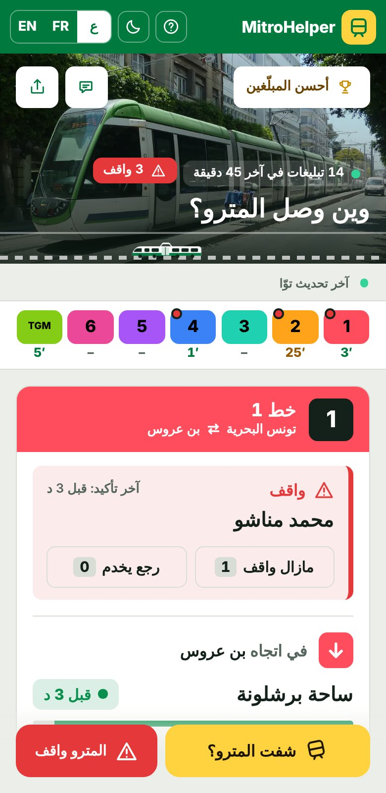
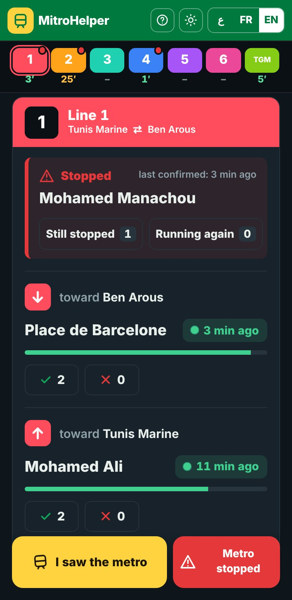
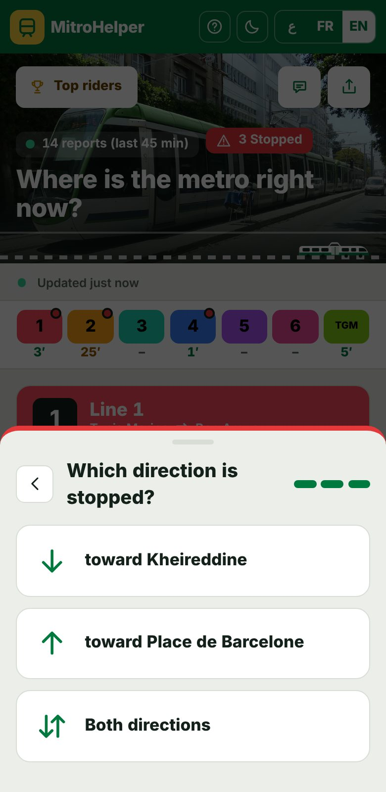
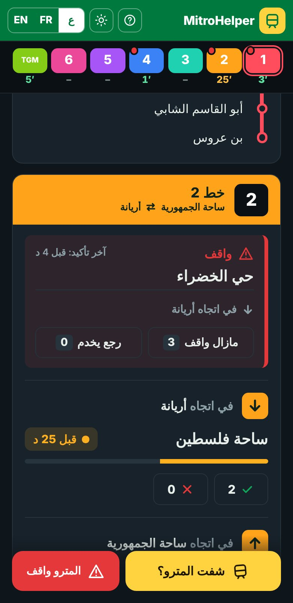

# MitroHelper

**Live Tunis metro tracker, powered by riders.**
Where is the metro right now? Riders report it in 3 taps, everyone sees it instantly.

### [Open the live site →](https://mitrohelper.dhia336.workers.dev/)

مترو تونس مباشر · Métro de Tunis en direct · Tunis Metro Live

> **About this repository:** this is a showcase of the project (what it does, how it is built, what I learned). The source code is private. Happy to walk through it in an interview or on a call.

  
  
  
  

Screenshots use sample data.

## What it does

MitroHelper shows where the Tunis light metro (Transtu lines 1 to 6 and the TGM) was last seen, based on live reports from riders.

- **See the metro:** latest sighting per line and direction, how long ago, and an estimate of the usual wait between trains.
- **Report in 3 taps:** line, station, direction. No sign-up.
- **Report a stoppage:** with the direction affected, so riders know whether it concerns them.
- **Confirm or deny:** riders vote on reports; wrong ones fade out and repeat offenders are paused automatically.
- **Own your reports:** you can see which reports are yours and remove them, still without an account.
- **Message the developers:** a small built-in form for ideas and bug reports.
- **Top riders:** a friendly weekly leaderboard of the most helpful reporters.
- **Works like an app:** installable (PWA), fast on weak connections, light and dark themes.
- **Three languages:** Tunisian Arabic (full right-to-left layout), French and English.

## Built with

| Part | Choice |
| --- | --- |
| Frontend | Plain JavaScript and CSS, no framework and no build step; installable PWA with a service worker |
| API | Cloudflare Workers, with edge caching so the live board stays fast under load |
| Database | PostgreSQL (Supabase) with row-level security; the browser never talks to the database directly |
| Bot protection | Cloudflare Turnstile, per-device and per-network rate limits, community voting |
| Moderation | A protected admin dashboard with two-factor login |

## Things I'm proud of

- **No accounts, still resistant to abuse.** Reports are tied to a random device ID instead of a login. Spam is limited by CAPTCHA, rate limits, voting, and automatic pausing, not by collecting personal data.
- **Fast reads.** The public live board is cached at the edge and only invalidated when something changes.
- **Real right-to-left support.** Arabic is a first-class language: mirrored layout, direction-aware text fields, and a translation system for three languages.
- **Measured UI quality.** I audited the interface with automated checks for contrast, touch-target size and overflow across phone sizes, themes and languages, then fixed what they found.
- **Data kept honest.** Rider feedback led me to check the station data against the official network map and fix missing stations.
- **Privacy by design.** Only a random device ID and hashed network identifiers are used, for abuse limits. No names, no emails, no accounts.

## Languages · Langues · اللغات

**العربية:** MitroHelper تطبيق مجاني يبيّن أين وصل مترو تونس الخفيف (الخطوط 1 إلى 6 وخط TGM) اعتمادًا على تبليغات الركّاب مباشرة. بلّغ عن مرور المترو أو توقّفه في 3 نقرات، وبلا حساب.

**Français :** MitroHelper est une application gratuite, alimentée par les usagers, qui montre où se trouve le métro léger de Tunis (lignes 1 à 6 et TGM). Signalez un passage ou un arrêt en 3 clics, sans compte.

**English:** MitroHelper is a free, rider-powered app showing where the Tunis light metro (lines 1 to 6 and TGM) is right now. Report a sighting or a stoppage in 3 taps, no account needed.

## Notes

- Community-reported information only: it is not official and may be inaccurate. This project is **not affiliated with Transtu**.
- Live site: <https://mitrohelper.dhia336.workers.dev/>

---

© 2026. All rights reserved. This repository contains documentation and screenshots only.
